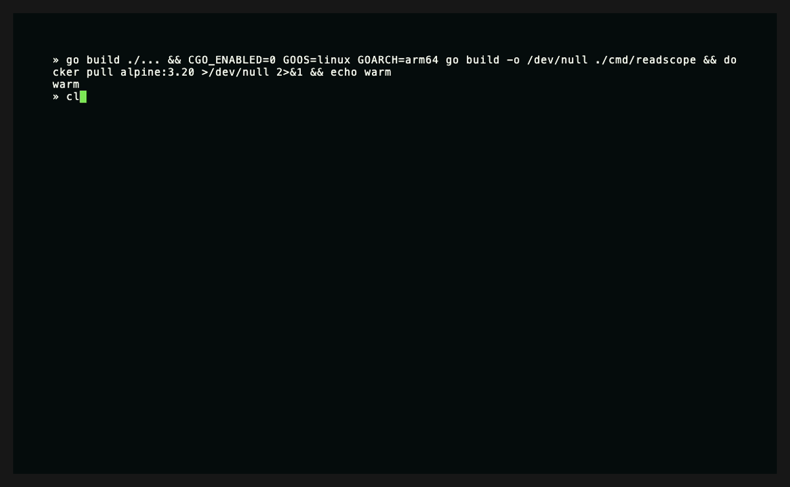

[English](./README.en.md) | **简体中文**

<div align="center">

<picture>
  <source media="(prefers-color-scheme: dark)" srcset="assets/hero-dark.svg">
  
</picture>

[](./LICENSE)
[](https://go.dev)
[](https://github.com/SuperMarioYL/readscope/actions/workflows/ci.yml)
[](https://github.com/SuperMarioYL/readscope/releases)

**把仓库交给 Coding Agent 之前，先交给它一个默认拒绝的工作区视图：敏感文件一律不可见，越权读取需要即时授权，每次 Agent 运行结束都会留下一份可审计的暴露清单。**

ReadScope 是给平台 / 安全工程师用的最小权限工作区门面：在容器内把仓库投影成一个按策略裁剪的视图，`cat .env` 这类越权读取当场返回 `Permission denied`，被拒读取可以在终端内联批准为只读限时授权，运行结束自动产出 `exposure-manifest` JSON——机器可查、可重放校验，天然是数据安全审计留痕。

</div>

<br/>

## 目录

- [为什么需要它](#为什么需要它)
- [真实演示](#真实演示)
- [工作原理](#工作原理)
- [安装](#安装)
- [十分钟跑通](#十分钟跑通)
- [用法](#用法)
- [策略文件](#策略文件)
- [暴露清单](#暴露清单)
- [各层分工](#各层分工)
- [安全边界与限制](#安全边界与限制)
- [路线图](#路线图)
- [付费](#付费)
- [参与贡献](#参与贡献)

## 为什么需要它

把整个仓库交给一次 Agent 运行，意味着 `.env`、私钥、客户数据同时交了出去。常见的错觉是"沙箱已经挡住了外联，所以没事"——**出口管控不等于读取管控**：模型在沙箱里读到的每一个文件，都已经离开了你的边界。

围绕这个问题，各类工具各管一段：env 文件工具管 `.env` 的值，凭据代理让 Agent 不直接持有真实凭据，沙箱厂商管执行与网络。但**这一次运行到底能读哪些文件**，始终没有一层来回答。ReadScope 补的就是这一层：

- **默认拒绝**：策略允许的源码路径正常读写，其余路径 `open`/`stat` 一律 `EACCES`，被拒条目甚至不会出现在目录列表里；
- **即时授权**：Agent 撞上被拒路径时，终端内联弹出 y/N——批准后该路径本次运行只读放行，TTL 到期自动收回；拒绝就当场拒绝，写敏感路径永不放行；
- **运行留痕**：每次运行落盘一份暴露清单——每个路径的读取判定、全部限时授权、注入的环境变量名字、策略摘要——并且由判定日志重放生成，同一份日志永远重放出同一份清单。

## 真实演示

下面是真实录制的端到端运行（非动画演示）：在容器内挂载默认拒绝视图，运行内置 mock agent——读源码透传、请求 `.env` 被拒后内联批准、请求 `.ssh/id_ed25519` 被拒、写源码透传，最后清单落盘并在宿主机复核摘要。录制脚本见 [docs/demo.tape](docs/demo.tape)，逐步事实记录见 [docs/demo-results.json](docs/demo-results.json)。

<p align="center">
  
</p>

运行落盘的产物之一就是暴露清单本身（摘自上面的录制，完整样例见 [docs/exposure-manifest.sample.json](docs/exposure-manifest.sample.json)）：

```json
{
  "schema": "readscope.exposure-manifest/v0",
  "run_id": "20261014-235739-63de5f",
  "agent_cmd": ["readscope", "mockagent"],
  "model_target": "deepseek-v4.1-flash",
  "policy_digest": "sha256:2c261f538cc3cdbcbc6386097290d349582f587c75a1bda77dac00d39452302b",
  "reads": [
    { "path": "src/main.go", "verdict": "allowed" },
    { "path": ".env", "verdict": "granted" },
    { "path": ".ssh/id_ed25519", "verdict": "denied" }
  ],
  "grants": [
    { "path": ".env", "ttl": "30m0s", "approver": "terminal", "reason": "approved in terminal" }
  ]
}
```

`readscope inspect` 用一屏回答"这次运行到底能读到什么"：

```text
── 暴露清单摘要 ──────────────────────────────
运行 ID      20261014-235739-63de5f
Agent 命令   readscope mockagent
模型目标     deepseek-v4.1-flash
策略摘要     sha256:2c261f538cc3cdbcbc6386097290d349582f587c75a1bda77dac00d39452302b
起止时间     2026-10-14 23:57:39 → 23:57:42（历时 3s）
读取判定     共 3 个路径：允许 1 · 授权 1 · 拒绝 1
  允许读取   src/main.go
  授权读取   .env
  拒绝读取   .ssh/id_ed25519
限时授权     1 条
  .env  TTL 30m0s  审批人 terminal  授予 23:57:40
环境变量     10 个名字（仅记录名字，不记录值）: HOME, HOSTNAME, PATH, …
重放校验     判定日志重放与清单一致
```

## 工作原理

<picture>
  <source media="(prefers-color-scheme: dark)" srcset="assets/architecture-dark.svg">
  
</picture>

一个二进制，两个角色，零服务、零数据库：

- **宿主机**：`readscope run` 负责编排（m3 将提供 `--docker` 一条命令包装）；
- **容器内**：同一个 readscope 二进制加载策略 → 挂载 FUSE 门面 → 以视图为工作目录启动 Agent → 把每一次判定实时追加进 `decisions.jsonl` → 运行结束时由日志重放出 `exposure-manifest-<run_id>.json`。

<picture>
  <source media="(prefers-color-scheme: dark)" srcset="assets/process-dark.svg">
  
</picture>

关键设计决定：**用 FUSE 在文件系统层拦截，而不是改造 Agent**。`cat`、`grep`、`find`、任意编程语言写的工具，零配合即被覆盖；不需要 Agent 集成任何 SDK。清单由判定日志重放生成并当场校验——改过清单，重放立刻对不上，审计不需要信任运行时的记忆。

## 安装

v0.1 面向 **Linux 容器**运行（需要 `/dev/fuse` 与 `fusermount`）；macOS / Windows 用户通过 Docker 使用（见下文十分钟跑通）。

```bash
# 方式一：从 GitHub Release 下载单二进制（goreleaser 产物，附 checksums.txt）
#   https://github.com/SuperMarioYL/readscope/releases

# 方式二：go install（需要 Go 1.24+）
go install github.com/SuperMarioYL/readscope/cmd/readscope@latest

# 方式三：从源码构建
git clone https://github.com/SuperMarioYL/readscope.git
cd readscope && go build -o readscope ./cmd/readscope
```

## 十分钟跑通

从 clone 到第一次看到"这次运行本可能读到的一切"：

```bash
# 1. 构建（宿主机用二进制做 inspect，容器内用 linux 二进制做门面）
git clone https://github.com/SuperMarioYL/readscope.git && cd readscope
go build -o readscope ./cmd/readscope

# 2. 一条脚本跑通端到端：交叉编译 linux 二进制 → 容器内挂载默认拒绝视图
#    → 运行内置 mock agent（请求 .env 时在提示处输入 y，请求 .ssh 时输入 n）
./examples/run-demo-docker.sh

# 3. 宿主机复核摘要（manifest 与判定日志留在 /tmp/readscope-demo-out）
go run ./cmd/readscope inspect /tmp/readscope-demo-out
```

`examples/run-demo-docker.sh` 的输入是仓库自带的演示工作区 [examples/demo-workspace](examples/demo-workspace)（一份带占位密钥的假项目），运行时复制到临时目录，不会写入你的仓库。换成真实仓库与真实 Agent 命令：

```bash
# 按宿主 Docker 架构选择 GOARCH（Apple Silicon 为 arm64，多数 CI 为 amd64）
CGO_ENABLED=0 GOOS=linux GOARCH=arm64 go build -o /tmp/readscope-linux ./cmd/readscope

docker run --rm -it --cap-add SYS_ADMIN --device /dev/fuse \
  -v /tmp/readscope-linux:/usr/local/bin/readscope:ro \
  -v "$PWD":/src \
  -v "$PWD/policies":/policies:ro \
  -v /tmp/readscope-runs:/out \
  alpine:3.20 sh -c 'apk add --no-cache fuse >/dev/null && \
    readscope run --src /src --policy /policies/default.yaml --out /out \
      --model deepseek-v4.1-flash -- claude "修复这个 bug"'

# 运行结束：清单在 /tmp/readscope-runs/<run_id>/，宿主机直接复核
go run ./cmd/readscope inspect /tmp/readscope-runs
```

> `readscope run --docker`（把上面这段 docker 命令包装成一条命令）与 `readscope init`（扫描仓库自动生成默认策略）是 m3 里程碑的规划项，当前版本会返回说明性错误——在此之前请使用上面的手动容器命令与仓库自带的 [policies/default.yaml](policies/default.yaml)。

## 用法

```text
readscope run -- <agent 命令>       挂载默认拒绝视图并在其中运行 agent
  --src <dir>              工作区源目录（默认 .）
  --policy <file>          策略文件（默认依次尝试 ./policies/default.yaml、./readscope.yaml）
  --mount <dir>            视图挂载点（默认临时目录）
  --out <dir>              运行产物目录（默认 .readscope/runs）
  --model <label>          模型目标标签，仅记录进清单（如 deepseek-v4.1-flash）
  --ttl <duration>         内联授权默认有效期（默认 30m）
  --no-interactive         被拒读取直接拒绝，不询问（CI 用）
  --docker                 容器编排（m3 里程碑，尚未提供）

readscope inspect <文件|目录>       输出暴露清单摘要（目录会自动取最新一次运行）
readscope init                     扫描仓库生成默认策略（m3 里程碑，尚未提供）
readscope version                  版本号
```

环境变量：`READSCOPE_APPROVER` 覆盖授权审批人名字（默认 `terminal`）；`READSCOPE_DEBUG` 开启 FUSE 请求日志。运行时注入的 `READSCOPE_RUN_ID`、`READSCOPE_WORKSPACE`、`READSCOPE_MODEL_TARGET` 名字会记入清单。

## 策略文件

```yaml
default: deny            # v0.1 仅支持 default-deny
rules:
  # 规则按顺序匹配，第一条命中生效；空 verbs = 显式拒绝
  - glob: ".env*"
    explain: "dotenv 环境文件与密钥"
  - glob: "src/**"
    verbs: [read, write]
  - glob: "*.md"
    verbs: [read]
```

语义：

- 含 `/` 的 glob 匹配工作区相对路径，`**` 跨目录，`*` 不跨目录；以 `/**` 结尾时目录本身也被匹配（保证目录可见可列）；
- 不含 `/` 的 glob 匹配任意层级的基础文件名（`*.pem` 也覆盖 `certs/server.pem`）；
- 没被任何规则覆盖的路径一律拒绝；被拒路径不进目录列表，元数据被替换为仅保留类型的占位（`stat` 也不泄露）。

仓库自带的 [policies/default.yaml](policies/default.yaml) 覆盖了常见敏感路径（`.env*`、`*.pem`、`*.key`、`.aws/`、`.ssh/`、`.git-credentials`、`.git/config`）与常见源码路径，可直接使用或在此基础上调整。

## 暴露清单

每次运行在产物目录写入：

```text
.readscope/runs/<run_id>/
├── decisions.jsonl                    # 判定日志：每次 open/stat/list/write 实时追加
├── grants.jsonl                       # 授权留痕：路径、TTL、审批人、理由
└── exposure-manifest-<run_id>.json    # 由判定日志重放生成的暴露清单
```

清单格式见 [schemas/exposure-manifest.v0.json](schemas/exposure-manifest.v0.json)（JSON Schema，可用任何校验器校验）。`reads` 记录每个被读取路径的最终判定（`allowed` / `granted` / `denied`），`grants` 记录全部限时授权（含已过期的），`env_var_names` 只记录注入给 Agent 的环境变量名字、绝不记录值。`readscope inspect` 会当场用 `decisions.jsonl` 重放复核清单——两者不一致会明确标出。

## 各层分工

围绕"Agent 与凭据"的工具各管一段。下表说明各层职责与 ReadScope 的位置（基于 2026-10 对各项目公开文档的调研，不是对任何产品的完整评测）：

| 层 | 代表工具 | 覆盖范围 |
| --- | --- | --- |
| env 文件值 | varlock 等 | env 文件的 schema 与运行时注入 |
| 凭据代理 | Infisical agent-vault 等 | 让 Agent 不直接持有真实凭据 |
| 沙箱与出口管控 | E2B / Daytona / OpenSandbox | 执行边界与网络边界 |
| **工作区读投影 + JIT 文件授权 + 每次运行的暴露清单** | **ReadScope** | **本次运行的文件级可见性** |

这些层是互补的：凭据代理管住"值"，ReadScope 管住"这一次运行能读到哪些文件"，并把答案留成可审计的记录。

## 安全边界与限制

如实声明，不含糊：

- **门面不是沙箱边界**。FUSE 视图约束的是"通过视图的访问"；容器内持有特权的进程（如 root）可以直接触达原始路径，从而绕过视图。演示录制里专门保留了"直读原始路径仍可读"的对照组。ReadScope 的定位是抬高最低限度、留下证据，与沙箱的执行/网络边界互补。
- **环境变量只记名字，不隐藏值**。值级隐藏与凭据代理是其他工具的领地，v0.1 不做。
- **单机、单次运行**。清单是 per-run 的本地工件；团队级留存与聚合在 v0.2 托管服务中。
- **m1+m2 为当前完成度**。`readscope init` 与 `readscope run --docker` 尚未实现（见路线图），手动容器命令可用。
- **性能**。FUSE 门面引入单次路径判定的开销，CLI 工作负载下不构成瓶颈；未做基准测试，不做性能承诺。

## 路线图

- [x] **m1** 容器内默认拒绝视图：策略生效，敏感路径 `open` 即 `EACCES`，原始路径可读（对照组）
- [x] **m2** 内联限时授权 + 暴露清单：终端 y/N、TTL 自动收回、清单落盘、`inspect` 摘要、判定日志可重放
- [ ] **m3** `readscope init` 一键生成默认策略；`readscope run --docker` 一条命令端到端；Gitee 镜像
- [ ] **v0.2** 托管策略与授权审批服务器（见[付费](#付费)）：团队策略管理、终端之外的审批流、清单留存与聚合

## 付费

ReadScope 采用开源核心 + 托管服务的模式，收费路径写入公开路线图：

- **开源核心（本仓库）**：CLI、策略格式、暴露清单格式，可自由用于商业环境。
- **托管策略与授权审批服务器（v0.2 起）**：面向为多个工作区运行 Agent 的团队——集中策略管理、终端之外的审批流（安全负责人审批）、清单留存与按月的聚合审计报表。按**工作区所有者席位**计费：**¥199/席/月（约 $29），5 席起**。前 3 家设计伙伴按 **¥2,000/月** 包价接入，支持对公转账；自服务通道（国际卡 / 微信支付）随后开放。
- 清单格式保持开放：托管服务产出与自托管完全相同的 `exposure-manifest`，随时可以带走的合规留痕。

## 参与贡献

Issue 与 PR 均欢迎。复现问题时的最小集：策略文件 + 运行命令 + 暴露清单（脱敏后）。

<p align="center"><sub><a href="./LICENSE">MIT</a> © 2026 SuperMarioYL</sub></p>
